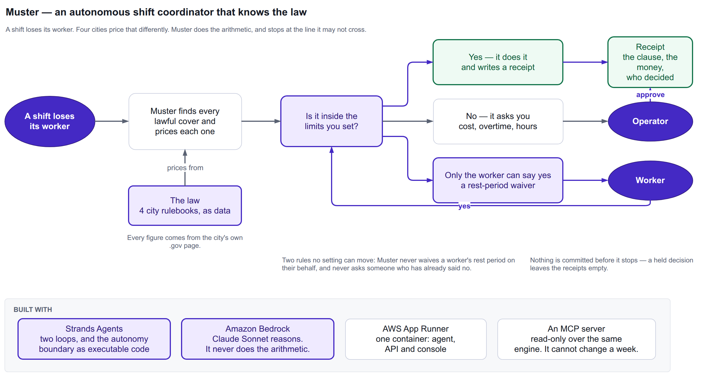

# Muster

**An autonomous shift coordinator that knows the law.**

Muster writes next week's roster for a small multi-site operator, then holds it
together all week — absorbing sick calls, no-shows and demand spikes, pricing every
legal way to cover the gap, and taking the cheapest one *inside the limits the
operator set*. It stops the moment a fix costs real money, or the moment the only
remaining option needs a worker's consent.

Built on the [Strands Agents SDK](https://strandsagents.com) against Amazon Bedrock
(Claude Sonnet 4.6), for the AWS *Agents for Humans* hackathon, Professional Agents
track.

---

## 1. The problem

Eleven US jurisdictions now regulate how shift schedules are written: written
notice, cash premiums when a posted schedule changes, extra pay when someone works
too soon after their last shift, and a worker's right to say no. The enforcement
against employers who get this wrong is not theoretical:

| | |
|---|---|
| New York City's DCWP settled with **Starbucks** — **more than $35.5M in restitution to over 15,000 workers**, an announced total of **$38.9M** | [NYC 311 / DCWP](https://portal.311.nyc.gov/article/?kanumber=KA-02719) |
| A multi-year DCWP investigation found **more than 500,000 violations** across **300+** NYC Starbucks locations | DCWP |
| The **Chipotle** settlement — **$20M**, August 2022 — was, at the time, the largest worker-protection settlement in New York City history | NYC Mayor's Office / DCWP |
| DCWP has also settled with **Dunkin'**, a **Taco Bell** franchisee, **Theory**, and **Walgreens** over the same law | NYC 311 |

Those are companies with legal departments. The operator Muster is built for has
neither, and faces the identical rulebook — enforced by the same regulator.

The rules are simple to state and hard to apply, because they interact: moving one
shift can trigger a premium under one clause, an overtime liability under another,
and a rest-period violation under a third, while a carve-out may or may not cancel
the first one out — and the answer changes by city. The moment that actually
matters, a 6am sick call, is the moment a manager has the least time to work any of
it out by hand.

### Why existing software doesn't close it

Homebase, 7shifts, Deputy, When I Work and Sling all schedule shifts. Some of them
warn about overtime. None of them, given a sick call, enumerate every legal way to
cover it, price each one against the governing city's ordinance, and take the
cheapest lawful option on their own. They render a calendar and leave the legal
reasoning to a person, at 6am, with none of the numbers in front of them.

---

## 2. Quick start

```bash
python -m venv .venv && source .venv/bin/activate
pip install -e .
```

Run the seeded demo — one sick call, priced and covered, end to end:

```bash
muster-demo
```

This makes a live call to Amazon Bedrock, so it needs AWS credentials for an
account with Bedrock access to `global.anthropic.claude-sonnet-4-6` in `us-east-1`
(both overridable via `MUSTER_MODEL_ID` / `MUSTER_AWS_REGION`). Without credentials
in scope, `muster-demo` prints a one-paragraph explanation and exits rather than
failing partway through a stack trace.

Run the read-only compliance server on its own, for any MCP client:

```bash
muster-mcp
```

Run the offline test suite (no credentials, no network):

```bash
pytest -m "not integration" -q
```

---

## 2a. Architecture



Two guards sit on the path, in this order. `PostingDependencyGuard` goes first
because its `Deny` short-circuits: a notification for a cover nobody approved must
never reach a policy that would judge it on its own merits and find nothing wrong.
Both pages are editable: [`docs/diagrams/muster-architecture.drawio`](docs/diagrams/muster-architecture.drawio), generated by [`build_architecture.py`](docs/diagrams/build_architecture.py). The second page,
[under the hood](docs/diagrams/muster-under-the-hood.png), names the machinery.

---

## 3. Which jurisdictions are encoded

The rulebook is data, not a branch in the code — one engine, one row per
jurisdiction, each figure carrying the primary `.gov` citation it was read from
(`src/muster/rulebook/data/*.json`). **Four rows are encoded and shipped today:**

| jurisdiction | code | effective from | notice | rest period | source |
|---|---|---|---|---|---|
| Oregon (statewide) | `us-or` | 2020-01-01 | 336 h (14 days) | 10.0 h, carve-outs apply | [BOLI](https://www.oregon.gov/boli/workers/pages/predictive-scheduling.aspx) |
| Chicago Fair Workweek | `us-il-chicago` | 2020-07-01 | 336 h (14 days) | 10.0 h, **no carve-outs** | [OLS FAQ v3.0](https://www.chicago.gov/content/dam/city/depts/bacp/OSL/faqfairworkweek09252025.pdf) |
| NYC Fair Workweek — fast food | `us-ny-nyc-fastfood` | 2017-11-26 | 336 h (14 days) | 11.0 h, **no carve-outs** | [DCWP / NYC 311](https://portal.311.nyc.gov/article/?kanumber=KA-02719) |
| NYC Fair Workweek — retail | `us-ny-nyc-retail` | 2017-11-26 | 72 h | 11.0 h, **no carve-outs** | [DCWP / NYC 311](https://portal.311.nyc.gov/article/?kanumber=KA-02719) |

**Seattle, San Francisco and Philadelphia are not yet encoded.** They are also
covered by predictive-scheduling ordinances, but no row for them exists in this
rulebook, and nothing in this project claims otherwise. The engine doesn't care how
many rows there are; adding one is a data file and a citation, not a code change.

The seeded demo world, **Sable Coffee**, puts one site in each of three of the four
encoded jurisdictions on purpose — the same 6am sick call at all three sites prices
differently under each city's own formula: Oregon's flat +1 hour / +½ rate and its
Oregon-only standby-list carve-out, Chicago's ≥50% cancellation pay and 1.25×/1.5×
rest premium with *no* carve-out that reaches its Right to Rest, and NYC fast
food's $10/$20/$45/$75 notice-band tiers plus a $100 clopening premium at the
11-hour rest line.

---

## 4. The autonomy dial

The operator sets how much authority Muster has. One setting moves four thresholds
at once, read directly from `src/muster/policy/rules.py::THRESHOLDS`:

| | conservative | balanced | trusted |
|---|---|---|---|
| Spends per incident, unattended, up to | $0.00 | $75.00 | $250.00 |
| Spends per week, unattended, up to | $0.00 | $400.00 | $1,500.00 |
| Tolerates overtime added per worker per week | 0.0 h | 2.0 h | 6.0 h |
| May take a worker below their good-faith hours by | 0% | 10% | 20% |

Thresholds compare with strict inequality, so a value exactly at a limit still
goes through unattended: $75.00 clears `balanced`, $75.01 does not.

At `conservative` the dial is not "off". Muster still resolves for free whatever it
can resolve for free — standby-list offers, worker-initiated swaps, covers that
fall outside the notice window entirely — because those cost nothing regardless of
the setting.

### Two rules ignore the dial, at every level

`rest_waiver_required` and `worker_declined` fire the same way at `conservative`,
`balanced` and `trusted`. No setting loosens either
(`src/muster/policy/rules.py::NON_NEGOTIABLE_RULES`), and `tests/evals/` asserts
this by breaking the policy on purpose and confirming the right tests go red.

This isn't a product opinion dressed up as ethics — it's the law's own structure:

- **Oregon** requires the worker's own request or consent before their rest period
  is shortened.
  ([BOLI](https://www.oregon.gov/boli/workers/pages/predictive-scheduling.aspx))
- **New York City** requires *written* consent for a clopening, and defines consent
  as agreement given after a meaningful opportunity to decline — not silence, not
  an unanswered notification.
  ([NYC 311 / DCWP](https://portal.311.nyc.gov/article/?kanumber=KA-02719))
- **Chicago's** own guidance states plainly that the Right to Rest "has no
  exceptions."
  ([OLS Fair Workweek FAQ v3.0](https://www.chicago.gov/content/dam/city/depts/bacp/OSL/faqfairworkweek09252025.pdf))

An agent that could waive a rest period or re-ask a worker who already said no, at
any autonomy setting, would not be a more capable product. It would be an unlawful
one.

---

## 5. The MCP server

The rulebook and the cost engine are the most reusable part of this project and the
safest thing to expose: deterministic, side-effect free, no credentials, no model
anywhere in the path. `muster-mcp` serves that core over the Model Context
Protocol, so any other agent can ask the same questions Muster asks itself.

| tool | answers |
|---|---|
| `list_jurisdictions()` | which rulebooks are encoded, their effective dates and citations |
| `get_rules(jurisdiction)` | the full rulebook record for one jurisdiction, including the `.gov` source |
| `price_schedule_change(...)` | what one change to a posted schedule owes, itemised by clause |
| `check_rest(...)` | the gap between two shifts, whether it breaches, the remedy owed, and whether consent is required |
| `audit_schedule(...)` | every rest breach across a whole posted week |

Plus a resource, `muster://rulebook/{code}`, so a client can read the cited rules
directly rather than trusting a summary of them.

**No write tools, deliberately.** Nothing exposed over MCP can move a shift, post a
schedule or record a consent — those stay behind the escalation policy inside
Muster, where a human's authority is modelled. An MCP client can ask what a change
would cost. It cannot change anyone's week.

---

## 6. Testing

```bash
pytest -m "not integration" -q      # every offline test — no credentials, no network
pytest -m integration -q            # billed; both loops against live Bedrock
```

Pure functions — notice bands, premiums, rest remedies, overtime, carve-outs — are
exhaustively unit-tested offline. `tests/evals/` is the safety argument, not a
coverage exercise: named scenarios an operator would recognise ("the standby list
is empty at 6am," "the only cover is a clopening," "the worker already said no
once"), asserting that no autonomy level can dial away rest consent or re-ask a
declined worker, and that raising the dial never *increases* the number of
escalations a given cover produces. Every one of those assertions was verified
capable of failing, by deliberately breaking the policy and recording which test
went red — the break-and-repair table is in `tests/evals/README.md`.

---

## 7. What the claim is, precisely

Muster cannot autonomously waive a worker's rest period, re-ask a worker who has
declined, spend past the limits the operator set, or claim a carve-out it cannot
evidence. Two honest qualifications on that, carried here rather than buried:

1. **This is not legal advice, and Muster is not a compliance guarantee.** It
   encodes published rules from named primary sources, with citations, as of a
   stated effective date. Ordinances change and are amended; an operator remains
   responsible for staying current with their own jurisdiction's law.
2. **Coverage tests are simplified.** Whether a given business is actually covered
   by one of these ordinances turns on employee counts, industry classification and
   franchise relationships. Muster takes the operator's declaration of coverage as
   given, rather than deciding it.

---

## License

MIT. See [`LICENSE`](LICENSE).
